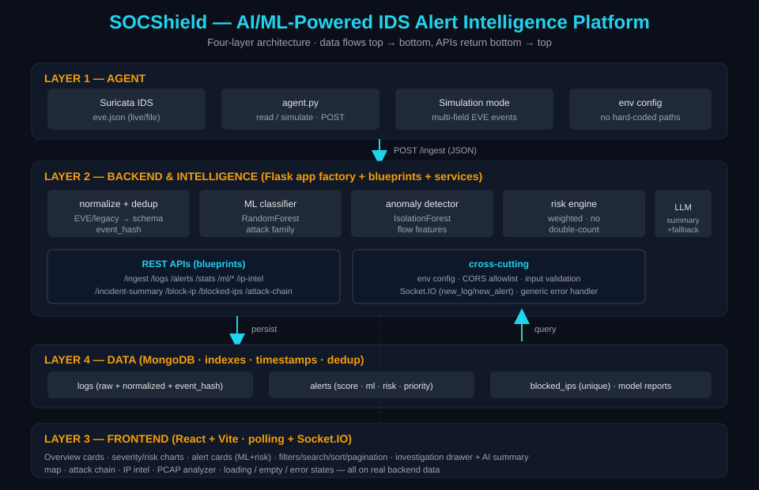
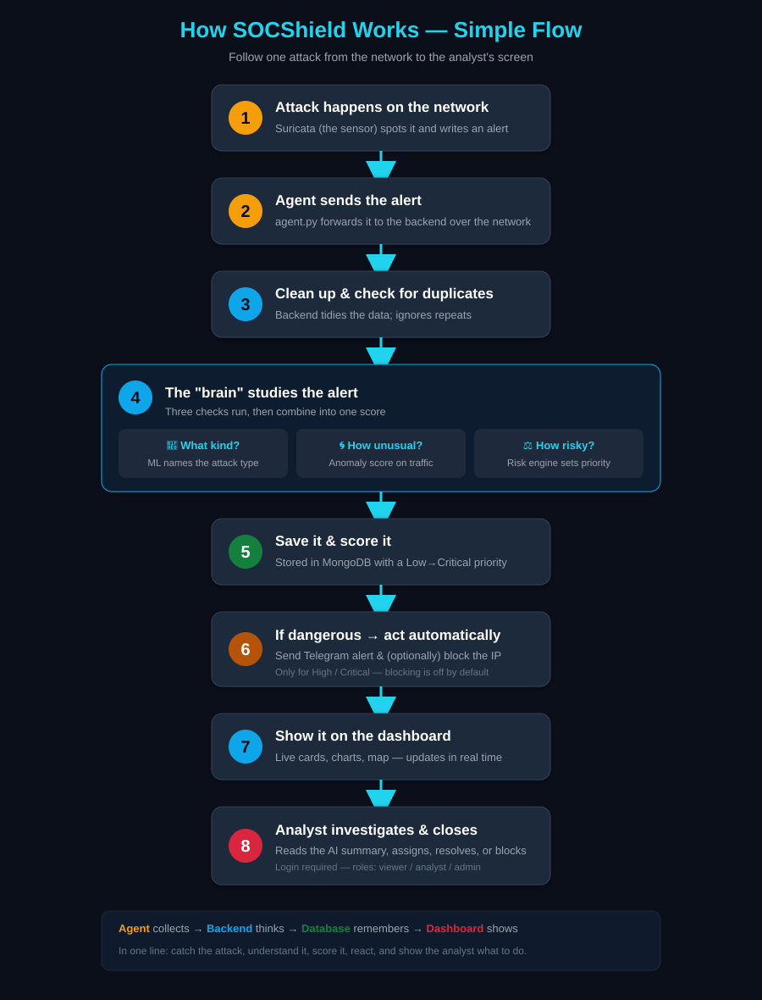

# SOCShield — AI/ML-Powered IDS Alert Intelligence Platform

SOCShield ingests Suricata IDS alerts, normalizes and de-duplicates them,
classifies the attack family with ML, scores network-flow anomalies,
computes a configurable risk priority, and (optionally) generates
AI-assisted incident summaries — surfaced in a real-time React SOC
dashboard.



---

## How it works (simple flow)

Follow one attack from the network to the analyst's screen:



| Step | What happens | In plain English |
|------|--------------|------------------|
| 1 | Suricata detects an attack | The sensor spots something bad on the network |
| 2 | Agent sends the alert | `agent.py` forwards it to the backend |
| 3 | Clean up + dedup | Backend tidies the data and ignores repeats |
| 4 | The "brain" studies it | What kind? (ML) · How unusual? (anomaly) · How risky? (risk engine) |
| 5 | Save + score | Stored in MongoDB with a Low→Critical priority |
| 6 | Auto-react if dangerous | Telegram alert + optional IP block (High/Critical only) |
| 7 | Show on dashboard | Live cards, charts, map — updates in real time |
| 8 | Analyst investigates | Reads the AI summary, assigns, resolves, or blocks (login required) |

**In one line:** Agent collects → Backend thinks → Database remembers → Dashboard shows.

---

## 1. Architecture (four layers)

| Layer | Tech | Responsibility |
|-------|------|----------------|
| **Agent** | Python | Read Suricata `eve.json` (live/file) or simulate realistic multi-field events; POST to `/ingest`. |
| **Backend & Intelligence** | Flask (app factory + blueprints + services) | Normalize, dedup, ML classify, anomaly score, risk-prioritize, persist, serve REST + Socket.IO, optional LLM summaries. |
| **Frontend** | React + Vite | Overview cards, charts, alert cards (ML + risk), filters/search/sort/pagination, investigation drawer + AI summary. |
| **Data** | MongoDB | Normalized logs, enriched alerts, blocked IPs; indexes, timestamps, dedup fingerprints. |

```
backend/
├── app.py                 app factory (registers blueprints, error handler)
├── config.py              env-based configuration (NO secrets in code)
├── extensions.py          Mongo client, collections, Socket.IO, ensure_indexes()
├── blueprints/            core, ingest, alerts, intel, response, pcap, stats, ml
├── services/              validation, scoring, intel, response, normalize, ingest, pcap
├── ml/                    labels, features, train_classifier, train_anomaly,
│                          inference, risk_engine, incident_ai
├── models/                saved .joblib models + *_report.json (generated)
└── tests/                 pytest suite (+ mongomock fixtures)
```

---

## 2. End-to-end data flow

1. Suricata emits an IDS event (or the agent simulates one).
2. Backend `/ingest` validates the JSON body and queues background processing.
3. The event is **normalized** (legacy 4-field OR full EVE) → canonical schema.
4. A **dedup** fingerprint (`event_hash`) suppresses identical events inside a short window.
5. The event is **persisted** to `logs` (raw + `normalized` + `ingested_at`).
6. For alerts: **rule score** (preserved) + **ML family** + **flow anomaly** are computed.
7. The **risk engine** combines available signals (no double-counting) → `risk_score` + `priority`.
8. An enriched **alert** is persisted (original severity kept separate from risk).
9. Optional **Telegram** notify + **config-gated** firewall block on High/Critical priority.
10. `new_log` / `new_alert` are emitted over Socket.IO; REST endpoints serve the data.
11. React renders alerts, risk, evidence, and on-demand AI incident summaries.
12. Analysts investigate, assign, resolve, block; blocked IPs are tracked.

Errors at any stage are caught and logged server-side; a failure in one
event never corrupts others or leaks tracebacks to clients.

---

## 3. Setup

### Prerequisites
- Python 3.10+, Node 18+, MongoDB 6+ (local or remote).

### Backend
```bash
cd backend
python3 -m venv venv
source venv/bin/activate          # Windows: venv\Scripts\activate
pip install -r requirements.txt
cp .env.example .env               # then edit .env with real values
python3 app.py                     # serves http://127.0.0.1:5000
```

### Agent
```bash
cd agent
python3 agent.py                   # choose mode: 1 file / 2 simulation / 3 live Suricata
# optional overrides:
#   SOCSHIELD_SERVER, SOCSHIELD_WIN_LOG, SOCSHIELD_SYS_LOG
```

### Frontend
```bash
cd frontend
npm install
npm run dev                        # http://127.0.0.1:5173
# optional: VITE_API_URL to point at a non-default backend
```

### Train the ML models (optional but recommended)
```bash
cd backend
# Classifier (attack family) — uses the signatures in eve.json
python -m ml.train_classifier --input ../suricata_logs/eve.json

# Anomaly detector — needs FLOW features; generate them with the agent's
# simulation mode first (capture its POSTed events), or use a Suricata
# sensor with flow logging enabled.
python -m ml.train_anomaly --input <flows.jsonl>
```
Models land in `models/` and are auto-loaded at runtime. Without them, the
backend runs fine and the risk engine falls back to the rule-based signal.

---

## 4. Running the tests
```bash
cd backend
source venv/bin/activate
pytest                 # runs the full suite
pytest -v              # verbose
```
- Pure-logic tests (scoring, validation, labels, normalize, risk engine,
  incident fallback) run with no external services.
- API + persistence + dedup tests use **mongomock** (in-memory Mongo) and
  are skipped automatically if mongomock is not installed.

---

## 5. Key REST endpoints

| Method | Path | Purpose |
|--------|------|---------|
| POST | `/ingest` | Ingest one event (validated). |
| GET | `/logs` | Logs (optional `?page=&limit=`). |
| GET | `/alerts` | Open alerts (optional `?page=&limit=&severity=`). |
| GET | `/stats` | Overview metrics + severity distribution. |
| POST | `/assign-alert`, `/resolve-alert` | Alert lifecycle. |
| POST | `/block-ip`, GET `/blocked-ips` | Response actions (config-gated). |
| GET | `/ip-intel/<ip>`, `/attack-chain` | Enrichment. |
| POST | `/upload-pcap` | PCAP analysis (extension-validated). |
| POST | `/ml/predict`, GET `/ml/status` | On-demand ML + model status. |
| GET | `/incident-summary/<alert_id>` | AI/fallback incident summary. |
| POST | `/auth/login`, `/auth/register` | Obtain a JWT / bootstrap first admin. |
| GET | `/auth/me`, `/auth/users` | Current user / list users (admin). |

---

## 5a. Authentication & roles

All endpoints require a JWT (set `AUTH_ENABLED=false` for local dev to bypass).
Obtain one via `POST /auth/login`. Roles: **viewer** (read), **analyst**
(ingest, assign/resolve, pcap), **admin** (block IP, manage users). The agent
authenticates to `/ingest` with a shared `INGEST_API_KEY` header. The first
`/auth/register` call bootstraps an admin; afterwards only admins can add users.
Set `SEED_ADMIN_PASSWORD` in `.env` to auto-create an admin at startup.

## 6. Security summary
See `SECURITY.md` for the full checklist. Highlights: env-based secrets,
restricted CORS, input/IP validation, no `shell=True`, config-gated
firewall blocking, generic error responses, prompt-injection defenses on
the LLM path, and a safe `.env.example`.

---

## 7. Known limitations
See `LIMITATIONS.md`. In short: the bundled `eve.json` is a simplified
4-field sample (no flow features), the classifier needs a larger labeled
dataset for robust metrics, anomaly detection requires real flow data,
and the platform has not undergone formal security testing — do not treat
it as production-secure without it.
